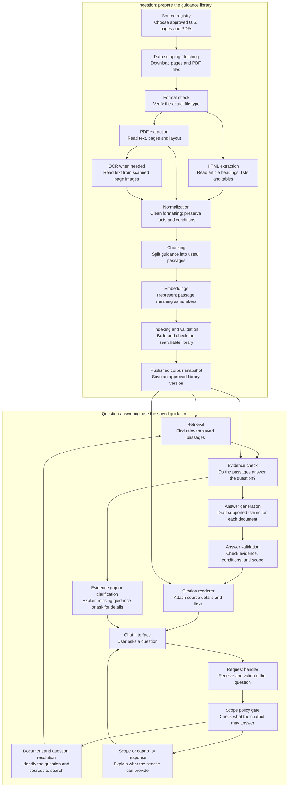
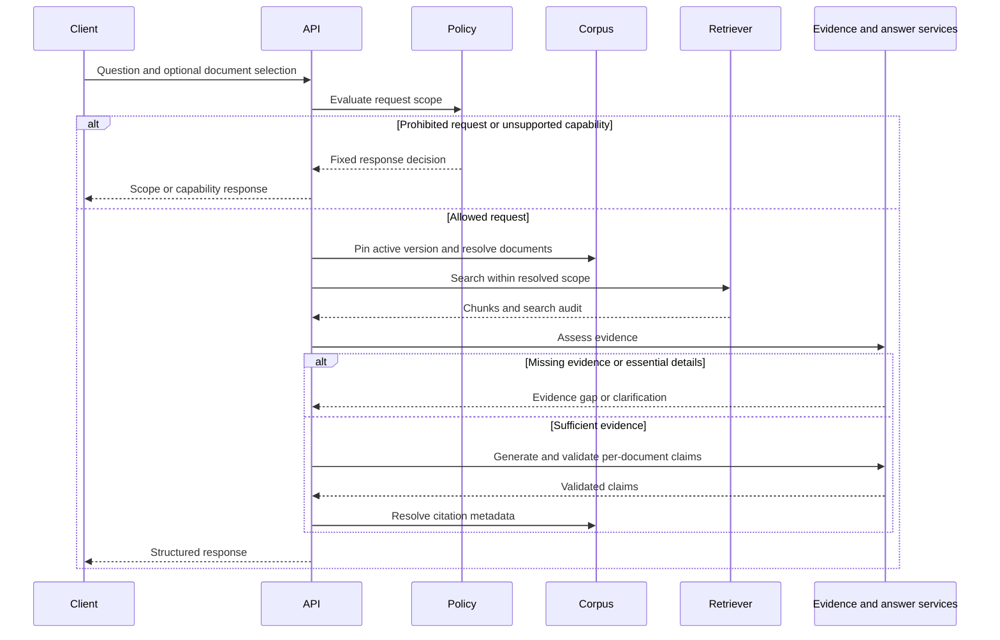

# Architecture: Dietary Guidance RAG Chatbot

## 1. Purpose and Design Status

This document describes an implementation plan for the [problem statement](problemStatement.md). The repository contains project documentation, a reviewed acquisition registry and its validation script, plus the Phase 0 package/settings/provenance foundations described in [phase0-foundations.md](phase0-foundations.md). P1.1/P1.2 implement registry eligibility and raw-artifact/SQLite provenance repositories; see [corpus foundations](phase1-corpus-foundation.md). P1.3–P1.6 implement reviewed-file imports, format inspection, bounded HTTPS fetching and administrative acquisition commands/reports; see [source acquisition](phase1-acquisition.md). P1.7 completes the acquisition coverage review and read-only audit, with 16 consumer families and six verified stored default PDFs; see [coverage review](phase1-coverage.md). Extraction, published corpus stores, retrieval, answering and HTTP endpoints below remain a build plan.

The service answers general food, nutrition, and household food-safety questions for a **U.S. audience**, using **a reviewed mixture of HTML guidance pages and PDF documents** from U.S. government, academic/clinical, and reviewed editorial publishers. Every factual claim must be supported by retrieved text and carry a citation. Answers involving several documents must preserve each document's contribution separately.

The milestone explicitly requires **HTML and PDF ingestion**, including at least **5 verified relevant official US PDFs** in the approved acquisition registry. Source types distinguish government, institutional, editorial and optional international references; access, rights, audience and content-role decisions control eligibility. Download landing pages are discovery records rather than the documents themselves. Individual-food nutrient values belong to Milestone 3 and are excluded from this RAG service.

The design has two independently operated paths:

- **Corpus ingestion:** Fetch, inspect, extract, chunk, embed, validate, and publish a versioned corpus.
- **Question answering:** Enforce scope, resolve document selection, retrieve evidence, assess support, generate claims, validate them, and render citations.

Recommended technologies and starting parameters are architecture decisions. They supplement the requirements rather than introduce an existing implementation or a mandated provider.

## 2. Requirements and Architectural Decisions

| Requirement | Architectural response |
| --- | --- |
| Mixed-format US guidance | Target 15–20 unique consumer families initially, allow a larger candidate/reference registry, and approve at least 5 verified official US PDFs. |
| Include government, academic/clinical, and editorial sources | Store source type, U.S. applicability, author/reviewer details, and eligible sections; preserve source authority in retrieval and answers. |
| Learn HTML and PDF ingestion | Detect actual format; route HTML to main-content parsing and PDFs to native text/layout extraction with page-specific OCR fallback, then normalize into shared blocks. |
| Inspect relevance, currency, audience and reuse | Record source selection and rights decisions; isolate clinical, scientific, historical and regulatory references; keep failed and restricted candidates unindexed. |
| Preserve source and location provenance | Store publisher, verified date/edition labels, direct/resolved URLs, retrieval time, format and PDF physical pages; never invent missing publication years. |
| Avoid splitting meaningful recommendations | Chunk by section and content block; preserve lists and table row context. |
| Support full-corpus and named-document retrieval | Apply document and corpus-version filters inside vector retrieval. |
| Answer only from retrieved passages | Generate structured claims with evidence references and validate them before display. |
| Cite every factual claim | Construct citations in application code from stored metadata. |
| Keep sources separate | Group evidence and final claims by document ID, including sources from the same publisher. |
| Say when guidance does not answer | Return an evidence-gap response listing the actual search scope. |
| Decline medical advice and calorie/weight targets | Apply code-enforced policy gates before retrieval and after generation. |
| Keep individual-food nutrient lookup separate | Return a dedicated capability response; do not estimate nutrient values through RAG. |
| Document chunking trade-offs | Record the strategy, parameters, extraction limitations, and evaluation findings in the README. |

## 3. System Overview

Think of the chatbot as a guide to a trusted library of approved U.S. food guidance and reference articles. First, it prepares that library by collecting and organizing web pages and PDF publications. Then, when someone asks a question, it searches the saved guidance, checks whether the passages support an answer, and shows the answer with its sources.

**Ingestion** means preparing the guidance library. **Question answering** means using that prepared library to respond to a user. The diagram names each technical stage and explains its job in everyday language.



### 3.1 Preparing the Library: Ingestion Components

| Component or term | Plain-language meaning | What it does here |
| --- | --- | --- |
| Ingestion | Bringing information into the system and preparing it for use. | Coordinates collection, cleaning, splitting, indexing, and publication of approved U.S. guidance and references. |
| Source registry / manifest | The approved reading list. | Lists approved U.S. URLs, document names, publishers, source types, and availability. |
| Data scraping / fetching | Collecting information from the publisher. | Downloads approved HTML pages and direct PDF files or accepts reviewed saved copies; records URL, time, format and content hash. |
| PDF text extraction | Reading the words already stored inside a PDF. | Preserves page positions, reading order, headings, captions and table relationships. |
| OCR | Reading words from a picture of a page. | Runs only when native text is absent or inadequate on a content-bearing page; retains confidence and page-image provenance for review. |
| Extraction | Picking out the useful content. | Keeps the actual guidance, headings, recommendations, and tables while removing navigation, cookie controls, and unrelated page content. |
| Normalization | Making the formatting consistent. | Tidies whitespace and represents lists and tables consistently while preserving values, units, labels, warnings, and conditions. |
| Chunking | Dividing a long article or document into useful passages. | Creates smaller sections that can be searched without separating a recommendation from its explanation or a table value from its header. |
| Embeddings | A numerical representation that helps match meaning. | Converts each passage into a list of numbers so a differently worded question can still find relevant guidance. |
| Indexing and storage | Building a searchable catalog and keeping the original evidence. | Stores the numerical representations in the vector index and the passage text and source details in SQLite. |
| Corpus snapshot / publication | Saving an approved version of the guidance library. | Makes a validated collection available to the chatbot and keeps its contents consistent for each answer. |

Both format-specific extractors feed a shared normalization stage before chunking. For example, repeated spaces can be cleaned up, but a temperature, storage duration, or warning must retain its original meaning. A table row must keep the food category, refrigerator/freezer column label, units, and any applicable notes together.

Preparation runs when building or refreshing the corpus. Chat requests search the saved library. Each request uses one published library version for both its evidence and citations.

### 3.2 Answering a Question: Runtime Components

| Component or term | Plain-language meaning | What it does here |
| --- | --- | --- |
| Chat interface and request handler | The front desk receiving the question. | Accepts the user's question and document selection, then checks that the request is valid. |
| Scope policy gate | A check on the kinds of help the service may give. | Declines medical advice and calorie/weight targets, and identifies individual-food nutrient lookups as a separate future capability. |
| Document and question resolution | Working out what the user means and which sources to consult. | Recognizes a named document, respects selected sources, and asks for clarification when the selection or intent is unclear. |
| Retrieval / vector search | Finding passages relevant to the question. | Searches the saved guidance by meaning, restricted to the selected documents when requested. |
| Evidence sufficiency assessment | Checking whether the passages actually contain an answer. | Verifies that the guidance covers the requested topic and necessary conditions; asks for missing details or explains an evidence gap. |
| Answer generation | Writing a readable response from the passages. | Drafts factual claims supported by the retrieved guidance, keeping each document's contribution separate. |
| Answer validation | Checking the draft before showing it. | Checks evidence references, quotations, numbers, conditions, source separation, and prohibited advice. |
| Citation rendering | Showing where each claim came from. | Attaches the document name, publisher, year, source type, and original publisher link using stored source details. |

Finding a passage and proving that it supports an answer are separate jobs. A passage can mention the right food yet describe freezing when the user asked about refrigeration. The evidence and answer checks must preserve that distinction.

### 3.3 Example in Everyday Terms

Suppose a user asks, "According to the Minnesota health department’s Cold Storage page, how should leftovers be stored?" During ingestion, the system collects that U.S. HTML page, extracts the relevant sections, cleans their formatting, and saves searchable passages with their source details and government source type. At question time, it resolves the named document and retrieves passages from that selected source. It checks whether those passages answer the question, drafts supported claims, and attaches citations. If essential details or supporting guidance are missing, it asks for clarification or explains what the searched document did not cover.

## 4. Recommended Prototype Stack

| Layer | Recommendation | Reason |
| --- | --- | --- |
| Language | Python 3.11 or later | Supports HTML/PDF processing, embeddings, validation, and a small API service. |
| API | FastAPI and Pydantic | Typed requests, structured responses, and explicit validation. |
| HTML fetching | HTTPX | Timeouts, redirect inspection, conditional requests, and response metadata. |
| HTML parsing | Beautiful Soup with lxml | Supports source-specific extraction and direct inspection of lists and tables. |
| PDF extraction | pypdf for native text/metadata; pdfplumber for word coordinates and tables | Produces page-aware text and preserves inspectable geometry; validate reading order against rendered pages. |
| PDF rendering and OCR | Poppler plus Tesseract, with OCRmyPDF optional | Renders review images and provides page-specific OCR for scanned/mixed files. Pin versions and review dependency licenses before deployment. |
| Registry validation | PyYAML and the existing validation script | Validates reviewed IDs, roles, formats, PDF metadata and duplicate-family defaults before ingestion. |
| Metadata and extracted content | SQLite | Stores document versions, blocks, chunks, provenance, and ingestion records locally. |
| Vector index | Chroma in persistent local mode | Provides similarity search and metadata filters without a separate service for the prototype. |
| Embeddings | Sentence Transformers behind an adapter | Allows local English-language embeddings and reproducible model configuration. |
| Generation and semantic assessment | Provider-neutral language-model adapter | Keeps orchestration independent of a specific hosted or local model. |
| Interface | Small HTML/JavaScript chat page served by the API | Provides document selection and readable citations with minimal frontend infrastructure. |
| Validation | pytest plus a curated question/evidence dataset | Checks behavior, extraction, retrieval, policy gates, and evidence support. |

The selected embedding model is `intfloat/e5-base-v2`, pinned to revision `f52bf8ec8c7124536f0efb74aca902b2995e5bcd`. Phase 2 chunking uses its hash-verified tokenizer and a verified 512-token input limit; embedding weights and dense retrieval remain Phase 3 work. Use its required query/passage prefixes and measure the complete input with its tokenizer. Other models can be substituted through the adapter, but changing the model or preprocessing requires rebuilding the index.

No orchestration framework is required. Keep the ingestion, retrieval, policy, and citation logic explicit so their behavior can be inspected and tested.

## 5. Component Responsibilities

| Component | Responsibility | Output |
| --- | --- | --- |
| Source registry | Defines eligible URLs, document IDs, publisher identity, parser profiles, and aliases. | Reviewed source entries. |
| Fetcher/importer | Obtains HTML/PDF and records acquisition details or failures. | Raw file snapshot, hash and fetch record. |
| HTML/PDF extractors | Isolate approved guidance and preserve reading order, table relationships and page locations. | Format-native blocks and inspection diagnostics. |
| OCR adapter | Extracts text from approved image-based content pages when required. | OCR blocks with page/geometry/confidence and review flags. |
| Normalizer | Converts both formats to common blocks without changing facts. | Reviewed canonical blocks plus original extraction artifacts. |
| Chunker | Creates coherent retrieval units within the embedding input budget. | Chunks with complete provenance. |
| Corpus builder | Embeds chunks, writes stores, runs validation, and publishes a snapshot. | Immutable corpus version. |
| Scope policy | Classifies prohibited advice and unsupported capabilities. | Allow, decline, capability, or clarification decision. |
| Document resolver | Maps selected IDs or recognized names to corpus documents. | Explicit search scope. |
| Retriever | Searches only the permitted documents in the pinned corpus. | Ranked chunk candidates and search audit. |
| Evidence assessor | Checks whether candidates actually answer the question and preserve conditions. | Supported aspects, missing details, or evidence gaps. |
| Generator | Produces atomic claims per document using supplied evidence. | Structured draft with evidence references. |
| Answer validator | Checks structure, scope, references, quotes, and semantic support. | Approved claims or a reason to withhold them. |
| Citation renderer | Resolves trusted metadata and formats each claim's citation. | User-facing answer and source objects. |

## 6. Source Registry and Initial Corpus

The implemented acquisition registry is [config/sources.yaml](../config/sources.yaml), with detailed findings in [sourceReview.md](sourceReview.md) and [P1.7 coverage review](phase1-coverage.md). It records 68 investigated URLs, retains all 20 existing IDs, verifies 12 official US PDFs, and approves 9 PDF assets with exclusions. Six PDFs are default consumer acquisitions; the dated Minnesota chart and older FDA PDFs remain comparison assets. Sixteen distinct eligible consumer families have current-snapshot byte-verified acquisitions, meeting the initial 15–20-family planning target before extraction/indexing. The [coverage audit](coverage-audit.json) separates eligibility, verified storage and publication; unavailable, restricted, alternate and reference-only assets do not inflate default coverage.

The YAML registry is the single source of truth for acquisition decisions. A published `manifest.json` later records the subset that actually passed extraction, chunking, rights and retrieval validation. Neither approval nor a successful fetch means an active vector corpus exists.

### 6.1 Fields and Selection States

Registry fields include `document_id`, `document_name`, `publisher`, `source_url`, `resolved_url`, `source_tier`, `jurisdiction`, `target_audience`, `intended_audience`, `content_role`, `family_id`, `format`, `detected_format`, `parser_profile`, source `dates`, `access`, `rights_review`, and `selection`. PDF entries also contain `direct_pdf_url`, `source_page_url` and `pdf` inspection metadata. The document ID remains stable even if content changes; alternate files receive their own IDs and a common family ID.

| Decision | Acquisition / indexing behavior |
| --- | --- |
| `approved_with_exclusions` | Eligible for local educational ingestion only after recorded scope/rights exclusions and extraction quality gates pass. |
| `pending_access` | Failed acquisition; preserve URL and diagnostics, do not index error content. |
| `pending_rights_review` | Relevant content retained; reuse scope unresolved, ingestion disabled. |
| `blocked_usage` | Explicit usage restriction observed; ingestion disabled unless an appropriate permission record is later obtained. |
| `reference_only` | Medical, scientific, historical, conflicting consumer or optional international reference; excluded from default consumer retrieval. |
| `discovery_only` | Locator or hub used for source/date discovery, not an evidence document. |
| `rejected_format` | Actual response differs from expected asset; not accepted as that document. |

`selection.default_index` is a proposed default, not a completed build. `approved_pdf_for_milestone` counts verified approved acquisition assets, including the dated chart benchmark; release tests separately require useful eligible chunks from both formats. Reference assets may be parsed into a separate experimental index, but are not merged into the consumer corpus. Named-document selection cannot bypass rights, availability or policy restrictions.

### 6.2 Source Authority, Audience and Currency

Use `official_guidance`, `institutional_reference`, `editorial_reference` and `international_reference` for publisher identity, independently of content role. U.S. state guidance remains state-issued. Medical review does not authorize personalized advice. General household guidance, specialized medical diets, scientific committee reports, historical guides and food-service regulatory documents have different applicability.

The 2025–2030 final Dietary Guidelines are current federal policy; the committee’s 2024 scientific report is advisory background. NIH CKD/diabetes/DASH content remains specialized; older 2005/2006 booklets are historical. The supplied Food Code 2026 URL failed acquisition and no edition was verified. Even an acquired Food Code is regulatory food-service guidance, not household advice. Optional WHO general references remain outside default US retrieval.

Record date labels honestly: edition is not publication year, an HTML page update does not update its linked PDF, and retrieval time is acquisition metadata. Sources with unknown dates retain null fields and visible date gaps. Review applicability/current status rather than automatically rejecting all older publications or assuming all government content is current.

### 6.3 Duplicate Formats, Rights and Coverage

The Minnesota contamination, grilling and chart HTML/PDF pairs share family IDs. For contamination and grilling, the PDF is the proposed default milestone asset, and existing HTML IDs/aliases resolve through the family when appropriate. For the chart, the HTML is proposed default and the explicitly dated 2006 PDF is a comparison asset. Compare versions and values before activating aliases; never silently substitute a changed recommendation. Only one default asset per family may enter an ordinary answer, and alternate copies do not provide independent corroboration.

HHS government text can be reused with attribution and recorded exclusions for contributed images. The scientific report includes an explicit reuse notice. Cleveland Clinic’s terms explicitly restrict automated harvesting/RAG use; its two existing IDs remain blocked. Harvard, Healthline and WebMD references remain relevant but unindexed pending text reuse clearance. Minnesota state works are not automatically federal public-domain works; recorded local educational extraction approval is not a blanket redistribution license. Recheck document-specific rights before public release.

Audit coverage across food groups/eating patterns, grains/fiber/fats, labels, contamination, cooking/thermometers, chilling, refrigeration/freezing and leftovers. Current gaps include accessible federal outage/pregnancy guidance and verified FDA seafood resources. Count unique eligible guidance families rather than URLs, PDF pages or alternate formats. A reviewed saved official file may be imported with its original URL, timestamp, hash and rights record; a blocked acquisition must never be replaced with an error page.

## 7. Data Model and Provenance

### 7.1 Corpus Version

Each published snapshot records a `corpus_version`, build time, included document versions, extraction/chunking configuration, embedding model revision, vector dimension, and validation report.

Versions are immutable. A request pins one version at entry and uses it for retrieval, metadata resolution, validation, and citation rendering.

### 7.2 Document and Document Version

| Field | Purpose |
| --- | --- |
| `document_id` | Stable identity across source updates. |
| `document_version_id` | Identifies one reviewed content and metadata version. |
| `document_name`, `publisher` | Required attribution. |
| `source_url`, `resolved_url` | Approved citation URL and the final validated fetch URL. |
| `publication_year`, `date_label`, `edition` | Verified publication year if established; independently labeled revision/update/edition or explicit unknown date for honest citations. |
| `published_at`, `updated_at`, `reviewed_at` | Separate source-stated dates, with their original labels. |
| `retrieved_at` | Actual acquisition time in UTC, not an earlier link-check date. |
| `jurisdiction`, `target_audience`, `language` | U.S. audience and federal/state or general-reference applicability. |
| `source_tier` | Official government, institutional, or editorial source identity. |
| `author`, `medical_reviewer`, `reviewer_credentials` | Source-stated attribution and review details, when present. |
| `eligible_sections`, `excluded_sections`, `eligibility_notes` | Section-level scope decisions and reasons. |
| `raw_hash`, `content_hash` | Detect changes to downloaded and extracted content. |
| `format`, `direct_pdf_url`, `page_count`, `text_classification` | Actual format and PDF provenance, with text/OCR/layout inspection details. |
| `family_id`, `content_role`, `rights_review`, `selection` | Duplicate-version identity, intended use and eligibility/permission gates. |
| `parser_version`, `ocr_version`, `fetch_status` | Reproducible extraction method/configuration and acquisition status. |

Do not invent publication years or derive them from retrieval dates. An update/review date may be displayed with its proper label, but must not silently become a publication date. A source missing a verified publication year retains a documented gap. Citation rendering uses an independently verified edition or properly labeled source date, or explicitly states “publication date not established”; it never fills the gap with a fabricated year. Review unknown-date currency before publication.

### 7.3 Content Block

Preserve the ordered structure of the extracted document before chunking. A block has a `block_id`, document version, block type, heading path, sequence position, text, and source anchor when present. PDF blocks also retain physical page indexes, printed page labels, bounding boxes, native/OCR method and quality indicators. A block may span pages; store all original locations.

Canonical block types include `heading`, `paragraph`, `recommendation_list`, `table`, and `note`; normalized tables retain explicit row references. Table blocks additionally retain the table title, column headers, row/group headers, units, and applicable footnotes. PDF table blocks preserve cell coordinates, original page images/geometry and any continuation headers across pages. This intermediate representation lets extraction and chunking be tested independently.

### 7.4 Chunk

The published corpus contract below is the target for Phase 3 onward. Implemented Phase 2 staging chunks resolve full document metadata through their immutable build, normalization and native-artifact records; build/snapshot IDs precede a published `corpus_version`. Exact block slices, original table/row links and native PDF region references are already stored in the separate `data/staging/chunks.sqlite` database and JSON exports. See [chunk contracts and inspection](phase2-chunking.md#persistence-and-inspection).

Every published chunk stores:

- `chunk_id`, `document_id`, `document_version_id`, and `corpus_version`.
- `document_name`, `publisher`, verified date/edition label, `format`, and `source_url`.
- `section_heading`, full `heading_path`, source anchor if available, and block IDs.
- `chunk_type`, ordered chunk position, canonical evidence text, and tokenizer count.
- Relevant conditions, units, table headers, and footnotes when applicable.
- `source_tier`, `target_audience`, jurisdiction, and a reference to the source eligibility decision.
- PDF physical pages, printed labels, source block bounding boxes and extraction method; OCR confidence/review state where applicable.
- `family_id`, content role and rights/eligibility decision, with only approved consumer blocks in the default index.
- Embedding model/configuration references and a text hash.

Generate chunk IDs deterministically from the document version, block location, canonical text, and chunker version. Identical builds should produce identical IDs; a changed passage must not reuse an old evidence identity.

SQLite stores the canonical chunk text and richer structural data. The vector index stores embeddings with filterable scalar metadata such as `document_id`, `document_version_id`, `corpus_version`, `source_tier`, and `target_audience`. Application code resolves full evidence and provenance from SQLite.

### 7.5 Search Audit and Claim

A search audit records the request ID, pinned corpus version, requested scope, actual searched document IDs, retrieved chunk IDs, ranking settings, and documents excluded because they were unavailable.

A draft claim contains `document_id`, `claim_text`, and one or more evidence references. Each reference includes a retrieved `chunk_id` and an exact `support_quote`. The model does not author publisher names, years, or source URLs.

## 8. HTML and PDF Ingestion Pipeline

1. **Validate registry entries:** Check publisher/domain, expected format, selection, rights, audience, family and parser profile. Discovery-only, unavailable, restricted and default-disabled references do not enter consumer ingestion.
2. **Fetch or import:** Download a bounded file, inspect redirects, record headers/status/time and SHA-256, and save the immutable original.
3. **Detect the actual format:** Validate MIME type together with file signature and parser readability. Accept readable HTML or real PDFs, never challenge/login pages. A `.pdf` URL can return an HTML shell, as observed for the WHO manual candidate.
4. **Extract with the appropriate adapter:** Parse HTML main content, or extract page-aware PDF text/layout. Run OCR only on content-bearing pages with absent/inadequate native text. Keep native and OCR artifacts separate for traceability.
5. **Normalize and apply exclusions:** Convert both outputs into shared ordered blocks, preserve facts/context, and remove reviewed prohibited or unrelated sections and unlicensed media.
6. **Resolve metadata and review quality:** Verify title, issuer, dates/edition, audience, page locations, reading order, list numbering, tables and footnotes against the original.
7. **Chunk and embed:** Build coherent units with complete provenance, actual tokenizer limits and family/eligibility filters.
8. **Validate the snapshot:** Check format mix, unique-family coverage, approved PDF metadata, text/table quality, citations, index dimensions and retrieval cases.
9. **Publish atomically:** Activate a complete consumer snapshot only after its stores and validation report agree. Scientific/medical/historical experiments use a distinct reference build.

### 8.1 Fetching and File Checks

Use HTTPS, bounded retries, a starting 20-second timeout and separate configurable HTML/PDF size limits. Long PDFs such as the 421-page scientific report require a larger administrative download budget, not unlimited uploads or chat-time fetching. Validate redirects against approved hosts and reject private/local destinations. Acquisition remains an administrative command, not an arbitrary-URL chat feature.

For PDF responses, verify `%PDF-` signature and successful open/page enumeration; record encryption, missing text, corruption and password requirements explicitly. A `download` URL without a `.pdf` suffix can still be valid. A successful HTTP status alone proves neither format nor usable content. HTTP 403/405, 404, DNS failures and access challenges remain acquisition diagnostics; do not bypass them or count them as searched guidance. PDF embedded scripts, attachments and links are not executed or crawled automatically.

### 8.2 HTML Extraction

Remove navigation, cookie controls, ads, product cards, sidebars, scripts, styles and repeated site footers. Apply source-specific main-content selectors and reviewed exclusions for medical treatment, supplements/dosing, calorie/weight targets, individual-food nutrient tables and non-US regulations. Preserve actual warnings and qualifications attached to retained recommendations.

Expand table row/column spans into logical headers, retain category labels and associate footnotes with rows. Store original HTML table structure beside the retrieval representation. Distinguish refrigeration/freezing and safety/quality. A publication-summary page with only a link is a discovery record; fetch its approved direct PDF as a separate asset.

### 8.3 PDF Native Text, Layout and OCR

Use native PDF extraction first. Inspect words/blocks with coordinates rather than trusting a flat text stream: two-column bullets can otherwise interleave, and table cells can detach from units. Identify recurring headers/footers by page position and repetition, preserving meaningful warnings and printed page labels. Carry bookmarks/headings into the heading path where reliable; infer headings conservatively and review them rather than asking a model to invent structure.

Assess each page for text presence and extraction quality. A sparse cover or intentional blank page is not automatically scanned. For an image-based content page, render at an OCR-appropriate resolution (start around 300 DPI), correct rotation/skew as needed, and OCR with bounded resources. Retain original image/page, engine/version/language, boxes and confidence. Do not OCR good native pages unnecessarily or append duplicate OCR text over existing selectable text. Low-confidence numbers, decimal points, symbols and safety units require review; unresolved content is quarantined from answer retrieval.

Tables need a dedicated layout pass. Retain row groups, column headers, units, cell positions, captions and footnotes; stitch multi-page continuations only when headers and structure establish the relationship. The Minnesota chart is a real table even when a detector returns no tables: combine geometry, source-specific rules and visual review. Keep a canonical table plus labeled row text for retrieval. Do not let generative summaries repair missing numeric cells.

For digitally drawn charts or images, retain available captions and adjacent explanatory text where permission permits. Visual-only recommendations require an explicit extraction/review method; otherwise record omitted content rather than inventing a text equivalent. Scanned content and complex figures are separate quality concerns.

### 8.4 Shared Cleaning and Normalization

Represent HTML and PDF output as the same typed blocks, while retaining format-native raw artifacts. Normalize Unicode and whitespace, remove duplicated responsive blocks or repeated page furniture, and cautiously join line-wrap hyphenation only when justified by the original text. Preserve true hyphenated terms, negations, °F/°C, fractions, time ranges, dosage-like quantities and footnote relationships. Do not change guidance values to make sources agree.

Apply exact block/region exclusions before chunking and verify that allowed blocks do not carry prohibited material from adjacent columns. For the sodium PDF, exclude the page-1 treatment callouts and the entire page-2 individual-food table; do not simply approve page 1 wholesale. HHS calorie/supplement passages likewise require region or paragraph decisions. Store each exclusion reason and original location.

### 8.5 Extraction Quality Gates

Compare sampled normalized text with rendered/original sources, covering every retained safety-critical table and each selected page layout. Check numeric cells, units, reading order, captions, list numbering, page mappings and omitted sections. Record OCR confidence and manual review scope honestly. Long scientific/historical PDFs are parser benchmarks and require a separate quality review before any reference experiment. Approval of an acquisition file is not approval of every extracted passage.

## 9. Chunking Strategy

Use **structure-aware chunking**: headings and complete recommendations define boundaries, with separate handling for prose, lists, independent cards and tables. P2C.1–P2C.3 implement this baseline; see [foundations and commands](phase2-chunking.md), [review results](chunking-review.json) and [exact inspection examples](examples/chunking/inspection.json).

### 9.1 Prose and Recommendations

- Combine adjacent related paragraphs only within the same section and reviewed layout region. Stop at topic, audience or condition changes represented by reviewed structure.
- Keep short HHS food-group cards and NHLBI dining tips independently searchable, even below the preferred token size. Native PDF region references enforce boundaries that headings alone cannot express.
- Keep conditions, exceptions and explanations with their recommendation, including the two-hour refrigeration rule and its one-hour hot-weather exception.
- Keep short lists together. Split oversized lists between top-level items, retaining nested explanations, qualifications, original numbering and exact introductory context. HTML sibling items from the same original list container can share a chunk.
- Use full headings as metadata and compact original document/section/audience context in embedding text. Do not create standalone heading embeddings.
- Split oversized prose at sentence boundaries. Overlap complete trailing sentences/condition groups up to **50 body tokens**; reduce overlap as needed to fit the next chunk. Do not overlap across sections, independent cards or table rows.

Boundaries are deterministic and rely on fidelity-reviewed structure and explicit sentence/condition rules. New source layouts require review; this baseline uses no LLM semantic splitting or hierarchical retrieval.

### 9.2 Table Chunks

Represent a row as labeled guidance text, retaining its table title, row category, column labels, values, units, and applicable notes. This is source-preserving serialization, not an opportunity for a model to invent summaries.

Illustrative structure, with no actual food-storage recommendation supplied:

```text
Section: [original heading]
Table: [original title]
Food/category: [original row label]
Condition: [original raw/cooked or opened/unopened label]
Refrigerator — [original temperature header]: [original cell]
Freezer — [original temperature header]: [original cell]
Notes: [applicable original footnote]
```

PDF page boundaries are provenance boundaries, not automatic chunk boundaries. Keep a recommendation or continued table together across pages when context requires it, retaining all contributing physical page indexes and printed labels. Never include repeated page headers as guidance.

Keep a small table together when its complete labeled input fits. For larger tables, use one row or a coherent row group per chunk, repeating headers and necessary notes. Preserve blank source values and references to original table structures; do not force HTML/PDF alternatives into identical layouts.

The current corpus uses these rules:

- **Minnesota storage chart:** group adjacent rows within the same category and budget; repeat refrigerator/freezer temperature headers and the quality qualification. Uncategorised products remain separate. Serialize blanks as `[blank in source]` while preserving empty values in canonical/native records.
- **CDC pregnancy table:** one food-category row per chunk, retaining both riskier and safer choices, pregnancy context and the applicable note.
- **Minnesota grilling table:** keep all six rows together when the fully labeled input fits; otherwise split coherent row groups and repeat the home-versus-regulated-facilities qualification.

### 9.3 Verified Token Budget and Trade-offs

The implemented default is a **350-token preferred target / 50-token sentence overlap**. The target is not a minimum or a hard cut: short complete evidence stays short, and an indivisible recommendation may exceed the preferred target while fitting the model limit.

Count the **complete embedding input**: `passage:`, original document/compact section/audience context, body and repeated table labels, plus special tokens. The pinned E5 tokenizer, model position limit and Sentence Transformers metadata agree on **512 tokens**. Verify file hashes against [the tokenizer manifest](../config/tokenizer-e5-base-v2.json), disable truncation, and quarantine an unfittable atomic recommendation/row and its build. Preparation explicitly downloads tokenizer/metadata files only; subsequent chunk builds are offline.

Consumer builds accept exact fidelity-reviewed default normalization and revalidate native artifacts. Comparisons have separate explicit snapshots and do not increase consumer coverage; quarantined OCR and project-created fixtures are unavailable to consumer chunking. Deterministic IDs and SQLite/JSON exports make blocks, rows, locations and configurations inspectable.

The reviewed baseline produces **269 chunks**, with full input lengths of **20 / 61 / 337 tokens** (minimum / median / maximum). The **250-token** alternative produces **274 chunks**, with a maximum of 263 tokens for a complete pregnancy row. Both achieve 16/16 complete-evidence hits@5 on the authored offline BM25 diagnostic. Retain 350/50; evaluate dense E5 retrieval and broader held-out questions before changing defaults. The lexical diagnostic does not establish dense retrieval or answer accuracy.

| Decision | Benefit | Cost or risk |
| --- | --- | --- |
| Preserve section context | Reduces ambiguous interpretation. | Consumes embedding and generation context. |
| Keep related recommendations together | Retains conditions and exceptions. | Larger chunks can be less focused. |
| Repeat table headers per row | Preserves units and storage meaning. | Adds duplicated tokens and vectors. |
| Add limited prose overlap | Helps retrieve boundary-spanning passages. | Produces near-duplicate hits that need deduplication. |
| Use source-specific extraction | Improves guidance quality. | Requires maintenance when websites change. |

The [README](../README.md) and [chunking guide](phase2-chunking.md) report the chosen parameters, table/list examples, exclusions/quarantine and measured trade-offs. Chunk size should change in response to evidence failures rather than arbitrary preference.

## 10. Embedding and Index Publication

Embed the canonical chunk representation with the pinned passage preprocessing. Embed questions with the corresponding query preprocessing. Store the model name, revision, tokenizer configuration, normalization setting, vector dimension, and distance metric in the snapshot manifest.

Configure cosine similarity consistently with the embedding representation. A query adapter must reject incompatible model/index configurations instead of comparing mismatched vectors.

Build a new SQLite database and Chroma directory together under a staging snapshot. Verify that every indexed chunk resolves to the same snapshot's canonical text and metadata and that every selected-document filter excludes other document IDs.

Publish by atomically replacing the active-version pointer after validation. Keep the previous snapshot available for in-flight requests and rollback. Do not mutate the active vector index while its metadata database remains at a different version.

For this small corpus, rebuilding a complete snapshot is preferable to introducing complex incremental updates. Content hashes can skip unnecessary embedding work, but metadata-only changes must still produce a traceable document/snapshot version.

## 11. Code-Enforced Scope Policy

### 11.1 Request Categories

| Category | Examples | Service behavior |
| --- | --- | --- |
| Allowed guidance | General balanced-diet, handling, cooking, or storage questions. | Continue to evidence retrieval. |
| Medical advice | A request to treat a condition, interpret symptoms, or recommend a medically personalized diet. | Decline and refer to a qualified professional. |
| Calorie/weight target | A requested calorie allowance, goal weight, or advice about what someone should weigh. | Decline and refer to a qualified professional. |
| Individual-food nutrient lookup | Nutrient amounts for a specified food or quantity. | Explain that this capability belongs to Milestone 3. |
| Ambiguous intent or missing essential context | An unclear request whose scope or food/storage conditions cannot be determined. | Ask a targeted clarification. |

General guideline quantities, including food-group portions and food-storage temperatures, are not automatically prohibited. Classify the requested advice: the presence of words such as "fat," "weight," or "calories" alone is not sufficient.

### 11.2 Enforcement Sequence

1. Apply deterministic checks for clear prohibited patterns and explicit requests to bypass the scope boundary.
2. Use a typed intent classifier for paraphrases and ambiguous requests; its output is data for the policy service, not permission to answer.
3. Let application code map the decision to an allowed route. A clear deterministic block cannot be overridden by the classifier or generator.
4. Return a fixed refusal/capability template when appropriate, without generating the requested advice.
5. Recheck generated claims for prohibited advice before rendering any answer.

Classifier failures or unresolved scope uncertainty must not fall through to unrestricted generation. Return a clarification or a service error, as appropriate. A classifier is still probabilistic; evaluate both missed prohibited requests and overblocking of general guidance.

For mixed requests, decline the prohibited portion and require a clearly separable allowed question before answering it. Never let retrieval of a related medical passage override the policy gate.

If conversational history is added later, re-evaluate the complete current intent on every turn. Prior user or assistant text can help resolve references but cannot serve as dietary evidence or weaken these restrictions.

## 12. Document Resolution and Retrieval

### 12.1 Resolve the Search Scope

Accept either the full active corpus or an explicit list of selected document IDs. A one-element list implements named-document retrieval; several IDs support an explicit comparison.

The UI should use IDs returned by the document registry. For natural-language requests such as "According to the Healthy Eating Plate...", resolve reviewed aliases to the corresponding ID and apply that restriction before searching. Ask for clarification if a name is ambiguous or contradicts the client's explicit selection.

Distinguish unknown IDs from known but unavailable sources. An unavailable selected source must not silently become a full-corpus search. When several documents are explicitly requested and one is unavailable, report the incomplete selection rather than silently omitting it.

### 12.2 Retrieve Candidate Evidence

1. Embed the resolved question using the snapshot's query configuration.
2. Search with mandatory `corpus_version`, eligible-chunk, and `target_audience=US` restrictions, plus selected document and source-type filters where applicable. Enforce default consumer content roles, rights approval and one canonical asset per family; source type alone cannot admit medical/regulatory material.
3. Begin with approximately 20 candidate chunks for ordinary questions; tune this against the expanded corpus rather than assuming the earlier smaller-corpus settings remain sufficient.
4. For explicit cross-document questions, retrieve a small candidate set per selected document, such as three chunks each, so one long document cannot crowd out the others.
5. Deduplicate overlapping evidence and resolve canonical chunks from SQLite.
6. Optionally rerank candidates with a local cross-encoder; validate the improvement before adding it to the baseline.
7. Select complete evidence units within the generation model's context budget, retaining required qualifications and table notes.

For broad multi-source questions without a selected list, run the per-document step across eligible active sources. The candidate budget grows with active document count, and a long PDF can dominate similarity hits; cap per-document/family contributions, then rerank and deduplicate before filling the model context. For an explicit large comparison, process document groups within a bounded request budget or ask for a narrower comparison. Evidence omitted because of context/time limits must not be mislabeled as guidance that was searched and did not cover the question.

Within relevant candidates, preserve source type and prioritize applicable government evidence for food-safety/regulatory claims. Explicit official-guidance requests restrict retrieval to `official_guidance`. Named-document restrictions still take precedence over an unsolicited fallback to other publishers. Sources without sufficient evidence receive no invented claims.

The baseline requires vector retrieval. An optional SQLite FTS5 search can improve matching of exact food labels, section names, and units. If added, apply the same document/version restrictions to both retrieval paths and merge ranks rather than treating their raw scores as comparable.

Do not use a universal similarity cutoff such as "0.7 means supported." Similarity measures relevance, not whether a passage answers the question. Calibrate candidate counts and any score thresholds on labeled queries for the actual model and corpus.

### 12.3 Record What Was Searched

Record the full active or selected document set searched, not just the documents producing top hits. Keep unavailable candidates separate from successfully searched documents. Use this audit to generate accurate evidence-gap messages and debugging traces.

## 13. Evidence Sufficiency and Clarification

Before drafting an answer, check whether the retrieved passages support the requested information.

For food-storage and cooking questions, evidence must match the relevant food/category, raw or cooked state, storage method, temperature context, and any stated packaging or time conditions. Do not transfer a duration between table rows or infer an unstated recommendation from a nearby food category.

| Evidence decision | Meaning | Response path |
| --- | --- | --- |
| `supported` | Retrieved passages answer the requested aspect with the necessary conditions. | Generate supported claims. |
| `partial` | Some aspects are supported; others are absent. | Answer supported aspects and identify the remaining gaps with search scope. |
| `needs_details` | Essential question details are missing. | Ask a concise clarification before giving condition-dependent guidance. |
| `not_covered` | Successful retrieval produced no sufficient evidence. | Explain the gap and name the searched documents. |

For example, "How long can I keep it?" needs the food and storage context. Asking for those details is different from declaring that the corpus lacks an answer. Likewise, a highly similar chunk about freezing does not answer a refrigeration question.

Evidence assessment can combine structured conditions with a language-model assessment, but the result must be represented explicitly and handled by application code. Automated semantic assessments are fallible and require review against a curated evidence dataset.

## 14. Grounded Generation and Citation Validation

### 14.1 Generation Contract

Supply the generator with the resolved question, per-document evidence groups, known chunk IDs, scope restrictions, source-type/U.S.-applicability metadata, and an output schema. Require atomic factual claims, each attributed to one document and supported by exact quotes from that document's retrieved chunks.

The draft schema should contain:

```text
document_answers[]:
  document_id
  claims[]:
    claim_text
    evidence[]:
      chunk_id
      support_quote
unanswered_aspects[]:
  aspect
  reason
```

The model must not generate source URLs, publisher names, publication years, or a separate unsupported summary paragraph. It may paraphrase retrieved guidance only while preserving its meaning, conditions, and scope.

Treat source passages as untrusted quoted content. Instructions embedded in HTML, PDF/OCR text, table notes, or user text must not change the policy or output contract. The answer generator has no source-fetching, code-execution, or unrelated external tools.

### 14.2 Validate Every Claim

Run the following checks before anything is displayed:

1. **Schema:** The draft parses and contains the required claim/evidence fields.
2. **Scope:** Every document ID belongs to the request's permitted search scope.
3. **Evidence identity:** Each chunk ID was actually retrieved for this request and belongs to the pinned corpus version.
4. **Source separation:** Every claim's supporting chunks belong to the claim's single document.
5. **Quote integrity:** Each support quote occurs in the canonical retrieved text after the same documented whitespace normalization.
6. **Conditions and numbers:** Claims preserve relevant negations, categories, units, temperatures, and duration qualifiers. Any permitted unit conversion must be deterministic and retain the original value; otherwise avoid conversion.
7. **Semantic support:** The claim follows from its quoted evidence and needed context, rather than merely sharing related words.
8. **Policy and applicability:** No claim supplies medical advice, a calorie/weight target, or an individual-food nutrient lookup; its conditions apply to the U.S. question, and its authority is labeled accurately.

Quote matching and valid IDs alone do not prove that a paraphrase is supported. Use a separate semantic verification step and evaluate it with human-labeled examples. A model serving as its own verifier may repeat the same mistake, so agreement is not a guarantee.

Allow at most one bounded repair attempt using the same evidence when the draft fails validation. If adequate evidence exists but generation or validation repeatedly fails, report a response-generation failure rather than falsely saying the corpus does not cover the topic. Return `not_covered` only when the evidence assessment supports that conclusion.

### 14.3 Render Citations in Code

Resolve each validated claim's document metadata from the pinned snapshot. Attach a citation containing **document name, publisher, verified date/edition label, source section/pages, and the approved source link** directly to the claim.

For PDF evidence, render direct-file links with physical `#page=N` references and list every relevant page when a chunk spans pages; separately show printed labels if useful. Do not infer physical indexes from printed numbering. HTML citations use verified source links/anchors. Resolve all locations from stored evidence, not model-authored URLs.

Show `source_tier` and federal/state or institutional/editorial identity beside source details. Secondary references must not be rendered as official guidelines. Present temperatures in °F for U.S. readers where appropriate; deterministic conversions retain the original source value.

Section headings and existing source anchors can provide extra detail. Do not invent fragment links. The source's retrieval date and stored evidence excerpt can be shown in an expandable source panel to help explain later website changes.

Escape all displayed text and use only registry-approved HTTP(S) citation URLs. Render generated text as text or sanitized Markdown, never as unrestricted HTML.

## 15. Cross-Document Answer Behavior

Group the final answer by document, including when two documents share a publisher. Show each document's name, jurisdiction, supported claims, and citations within its own section.

Do not create an aggregate recommendation such as "the guidelines say" from several documents. A claim needing evidence from two different documents violates the per-document generation contract and must be split or removed.

For explicit comparisons, preserve different recommendations or different conditions without choosing a synthesized value. For example, differing U.S. federal/state storage guidance or a secondary explanation must not be averaged into a new duration or recast as a new government recommendation. If a requested document lacks relevant evidence, state that gap for the document while presenting supported guidance from the others.

Cross-document retrieval improves discovery; it does not authorize blending guidance into personalized advice.

## 16. Runtime Orchestration and Response States



Use these application response states:

| State | Meaning |
| --- | --- |
| `answered` | At least one validated claim is available; any unanswered aspects remain explicit. |
| `not_covered` | The searched evidence did not answer the question. |
| `out_of_scope` | Medical advice or calorie/weight targets were declined, with professional referral. |
| `requires_structured_data` | The request belongs to the future individual-food nutrient capability. |
| `needs_clarification` | Document selection, intent, or necessary food/storage conditions are unclear. |

Service errors use a separate error contract and appropriate non-2xx HTTP status. Never translate model timeouts, index failures, unavailable documents, or invalid metadata into a missing-evidence refusal.

## 17. API Contracts

### 17.1 Endpoints

| Endpoint | Purpose |
| --- | --- |
| `GET /health/live` | Check that the process is running. |
| `GET /health/ready` | Check corpus/index compatibility and required dependencies; report unavailable readiness explicitly. |
| `GET /api/v1/documents` | List documents, IDs, provenance, availability, and the active corpus version. |
| `POST /api/v1/chat` | Apply policy and answer a question within the selected corpus scope. |

Ingestion and corpus publication are administrative CLI operations, not public chat endpoints. The baseline API is stateless; server-side conversation memory is an optional later feature.

### 17.2 Request Schema

```json
{
  "question": "What does Healthy Eating for Adults & Older Adults say about food groups?",
  "scope": {
    "mode": "selected",
    "document_ids": ["hhs_adults_older_adults_pdf"]
  }
}
```

For a full-corpus query, use `"scope": {"mode": "all"}`. For an explicit comparison, select multiple document IDs. Reject an empty selected list, unknown fields where they obscure scope, oversized input, and contradictory scope formats.

Begin with a configurable 2,000-character question limit and a configurable selected-document limit based on the active corpus and request budget (start at 20). An optional `source_tiers` list restricts the approved source types; default retrieval includes only active approved consumer assets; a source-tier filter may narrow that subset but never enable restricted/reference-only records. The backend always enforces U.S. applicability. The API must validate limits and deduplicate IDs before orchestration.

### 17.3 Successful Response Schema

The following is a structural example, not dietary guidance. Placeholder claim and quote text would fail a real evidence-validation run.

```json
{
  "request_id": "example-request",
  "status": "answered",
  "corpus_version": "example-corpus-version",
  "message": null,
  "document_answers": [
    {
      "document_id": "hhs_adults_older_adults_pdf",
      "claims": [
        {
          "text": "<validated claim from the retrieved guidance>",
          "citation_ids": ["citation-1"]
        }
      ]
    }
  ],
  "citations": [
    {
      "citation_id": "citation-1",
      "document_id": "hhs_adults_older_adults_pdf",
      "document_name": "Healthy Eating for Adults & Older Adults",
      "publisher": "HHS / Office of Disease Prevention and Health Promotion",
      "source_tier": "official_guidance",
      "publication_year": 2026,
      "date_label": "2026 publication",
      "format": "pdf",
      "physical_pages": [1],
      "printed_page_labels": ["1"],
      "source_url": "https://odphp.health.gov/sites/default/files/2026-10/dga-adults.pdf#page=1",
      "section_heading": "<retrieved section heading>",
      "chunk_ids": ["example-chunk"],
      "support_quotes": ["<verbatim retrieved evidence>"]
    }
  ],
  "searched_documents": ["hhs_adults_older_adults_pdf"],
  "unanswered_aspects": []
}
```

All citation values are filled from stored evidence and verified metadata at runtime, including source date labels and PDF page references. `message` holds a fixed refusal, capability explanation, clarification, or evidence-gap message where applicable. Pre-retrieval refusals have no fabricated citations or searched-document list.

### 17.4 Error Contract

| HTTP status / code | Behavior |
| --- | --- |
| `422 / invalid_request` | Return input validation details. |
| `404 / unknown_document` | Report the unrecognized selected ID. |
| `409 / source_unavailable` | Identify a requested source whose guidance is not available in the active snapshot. |
| `503 / corpus_unavailable` | Report an absent or incompatible corpus/index. |
| `503 / model_unavailable` | Report a generation/classification dependency failure. |
| `502 / answer_validation_failed` | Withhold a repeatedly invalid draft; do not present it as unsupported guidance. |
| `504 / request_timeout` | Report that the answer could not be completed within the configured deadline. |

Error bodies contain a request ID, stable error code, and a concise message, without raw provider exceptions or secret configuration. Conversational refusals and evidence gaps normally use HTTP 200 with their explicit application state.

## 18. Proposed Repository Layout

The registry, validator, Phase 0 foundations and P1.1/P1.2 registry/artifact/SQLite provenance modules/tests now exist. Other component directories have scaffolding; acquisition adapters, parsing, vectors/models, API handlers and UI implementations remain planned.

```text
docs/
  problemStatement.txt
  problemStatement.md
  architecture.md
  sourceReview.md
scripts/
  validate_source_registry.py # Implemented acquisition-registry checks
config/
  sources.yaml
  settings.yaml
src/dietary_rag/
  api/                 # Request/response schemas and HTTP handlers
  ingestion/           # Fetching, imports, parsers, chunking, corpus builds
  corpus/              # Version manager, SQLite repository, source registry
  retrieval/           # Embeddings, vector search, optional ranking
  policy/              # Request categories, code gates, response templates
  answering/           # Evidence assessment, generation, validation, citations
  providers/           # Model interfaces and backend adapters
  cli.py
web/
  index.html
  app.js
  styles.css
tests/
  fixtures/html/       # Reviewed HTML examples, including complex tables
  fixtures/pdf/        # Appropriate native-text, scanned, mixed and table fixtures
  unit/
  integration/
  evaluation/          # Questions, expected evidence, and policy labels
data/
  staging/
  corpora/<version>/
    manifest.json
    raw/
    documents.sqlite
    chroma/
    validation.json
  active.json          # Pointer to a validated corpus version
.env.example
pyproject.toml
README.md
```

Keep runtime corpora, downloaded pages, local model caches, logs, and secrets outside version control. Commit source configuration, parser logic, and small appropriate test fixtures needed to reproduce behavior.

## 19. Deployment, Configuration, and Operations

### 19.1 Prototype Deployment

Run one API process with a persistent local data directory and separately invoked ingestion CLI. Serve the minimal chat interface from the same application. Keep the Chroma and SQLite resources associated with each snapshot together.

The first deployment can use a local environment or a single container. Multiple API workers, remote vector storage, and background job queues are later scaling choices for a small mixed-format corpus. Long PDF size affects ingestion cost separately from source count. Check the selected embedded-store backend's process constraints before introducing concurrent writers.

### 19.2 Configuration

Configure the data directory, source manifest, embedding model/revision, model backend, chunk token budget, retrieval limits, request deadline, input limits, and logging behavior. Keep credentials in environment variables or the deployment's secret store.

Use compatible embedding settings at build and query time. Establish an overall request deadline and bounded model retries; avoid retrying each stage independently until the total request exceeds its budget. Hosted model use should be documented because it sends the question and supplied guidance excerpts to the configured provider.

Render the completed validated response rather than streaming unvalidated claims. Streaming can be reconsidered only with a design that preserves the same pre-display validation guarantees.

### 19.3 Source Updates

Re-fetch sources on an operator-selected schedule using conditional requests where supported. Compare content and metadata hashes, inspect meaningful changes, rebuild the snapshot, run validation, and activate the new version.

Do not replace a previously valid source with a current access-denied page. A failed refresh can leave the prior reviewed snapshot active, with its retrieval date and refresh failure visible. If a source is withdrawn or its currency cannot be accepted, explicitly retire it and rebuild the corpus.

### 19.4 Observability and Data Handling

Measure retrieval/generation latency, model call counts, token usage, response states, validation failures, ingestion failures, active source count, and corpus version. Record the search audit needed to reproduce evidence selection.

Avoid storing raw user questions or health details in routine logs. Use opt-in diagnostic capture with documented retention when necessary. Do not log API keys, full provider errors, or complete conversations by default.

Operational metrics must distinguish `not_covered` from service failure and distinguish policy declines from nutrient-capability routing. A rise in missing-evidence responses can indicate retrieval or extraction defects rather than genuinely limited guidance.

## 20. Validation and Evaluation Plan

### 20.1 Automated Checks

| Area | Meaningful checks |
| --- | --- |
| Fetching and format detection | Accept real HTML/PDF, reject challenge pages and HTML shells masquerading as PDFs, inspect redirects and keep unavailable sources unindexed. |
| PDF/OCR extraction | Check page count, reading order, physical/printed page mapping, native/scanned/mixed-page routing, OCR numeric fidelity and quarantine of unresolved cells. |
| Registry and rights | Preserve existing IDs, require at least 5 verified approved official US PDFs, keep restricted/reference roles out of defaults and prevent duplicate-family activation. |
| Extraction | Preserve recommendation numbers, heading context, row/column spans, footnotes, units, and safety/quality distinctions. |
| Chunking | Fit the real tokenizer limit without truncation and retain required metadata on every chunk. |
| Indexing | Reject embedding mismatches and resolve every vector to its canonical snapshot chunk. |
| Document and source filtering | Selected-document queries never retrieve another document's chunks; official-only requests exclude secondary sources, and all requests enforce U.S. applicability. |
| Policy | Decline medical and calorie/weight targets, including paraphrases; allow ordinary guidance and storage questions. |
| Grounding | Reject unknown chunk IDs, mismatched quotes, unsupported numeric claims, omitted conditions, and cross-source claims. |
| Refusals | Name actual searched sources for evidence gaps and never fabricate a search for pre-retrieval declines. |
| Failure handling | Keep source/model/index outages distinct from evidence gaps. |
| Versioning | In-flight requests use one consistent snapshot across retrieval and citation rendering. |

Use reviewed local HTML and PDF fixtures for deterministic parser tests. Include a labeled scanned or mixed fixture even though the ten verified official PDFs mainly contain native text; do not claim OCR was tested by native-text extraction. Include two-column content, a table with missed automatic detection, a multi-page table and a physical/printed page mismatch. Network-dependent checks belong to ingestion smoke checks and must not make every test run depend on website availability. Include deliberately malformed drafts and prompt-injection text in validation tests.

### 20.2 Curated Evaluation Dataset

Begin with approximately 60 to 80 reviewed questions spanning nutrition, food storage, cooking, named-document retrieval, cross-document requests, missing evidence, ambiguous conditions, prohibited advice, and individual-food nutrient lookup.

For each question, record the expected response category, permitted document scope, relevant evidence passages, essential conditions, and forbidden unsupported claims. Include both positive guidance questions and near-miss table rows that are topically similar but do not answer the question.

Measure retrieval recall at the configured candidate count, claim support, citation completeness, document-filter correctness, refusal accuracy, and latency. Track cross-document coverage separately so a relevant second source is not hidden by the dominant source. Include official-versus-editorial conflicts, duplicated explanations, excluded medical/calorie sections, and questions about U.S. labels and temperature units.

Structural requirements such as citation fields and document filters should pass every corresponding automated case. Semantic grounding and policy behavior require human review of representative answers in addition to model-based scoring. Passing the dataset is evidence of prototype quality, not proof that future model outputs can never fail.

### 20.3 Release Gate

Publish a prototype corpus and demonstrate the chatbot only when:

- Both HTML and PDF pipelines produce reviewed chunks and retrieval/citation evidence; at least 5 official US PDFs pass acquisition/metadata checks.
- Target at least 15 distinct consumer guidance families, allowing expansion beyond 20 registry URLs. Unavailable, restricted, duplicate and reference-only assets do not inflate consumer coverage. Disclose any scope/coverage shortfall.
- Native PDF text/layout and a separately labeled OCR fixture pass quality checks, with physical page citations verified.
- Source types are visible and accurate; official-only and U.S.-applicability filters work.
- Coverage across nutrition, labeling, handling, cooking, and storage is reviewed, including HTML/PDF table context and age/population applicability.
- Ineligible blocks, unavailable/restricted sources and specialized medical/regulatory/scientific/historical references remain outside the default consumer index.
- Every chunk resolves to complete metadata and canonical source text.
- Full-corpus and named-document retrieval work on reviewed questions.
- Displayed factual claims pass citation/reference checks and evidence-support review.
- Multi-document answers remain separated by document.
- Both required refusal behaviors and the separate nutrient-capability response are demonstrated.
- Known unavailable sources, metadata gaps, and evaluation failures are disclosed.
- The README explains chunking choices, how to build the corpus, how to run the service, and relevant limitations.

## 21. Implementation Sequence

| Phase | Work | Completion evidence |
| --- | --- | --- |
| 1. Corpus foundation | Implement the registry, fetch/import path, provenance records, and source status handling. | Existing registry validated; mixed HTML/PDF acquisition, at least 5 verified official PDFs, explicit rights/source roles and an honest unique-family coverage audit. |
| 2. Extraction and chunking | Add HTML/PDF parsers, native extraction, OCR fallback, shared normalized blocks and table-aware/page-aware chunks. | Native/scanned/mixed and table fixtures preserve text, context and PDF page citations; excluded regions remain unindexed. |
| 3. Embedding and retrieval | Build a versioned vector index and implement scope filters. | Relevant chunks retrieved across the corpus and within a named document. |
| 4. Policy and response contracts | Implement code gates, fixed responses, document resolution, and error states. | Reviewed scope cases route correctly before unrestricted generation. |
| 5. Grounded answering | Add evidence assessment, structured generation, per-claim validation, and citation rendering. | Claims trace to retrieved passages with complete citations. |
| 6. Cross-document interface | Add multi-source retrieval, document-grouped responses, and the minimal chat UI. | Comparisons preserve source attribution and show document-specific gaps. |
| 7. Evaluation and operation | Complete curated evaluation, snapshot promotion/rollback, observability, and README instructions. | A reproducible prototype passes its documented release gate. |

Keep retrieval inspectable before adding generation. A reliable retriever and citation renderer make grounding failures easier to diagnose than building the whole conversational path at once.

## 22. Principal Risks and Future Extension

| Risk | Mitigation |
| --- | --- |
| Official sources block collection or change layout | Explicit unavailable states, reviewed HTML/PDF imports, parser fixtures, and controlled refreshes. |
| PDF columns, scans or tables lose information | Page/geometry-aware extraction, bounded OCR, rendered comparisons and quarantine of ambiguous numeric cells. |
| Relevant public articles restrict reuse | Record actual notices and permissions; retain restricted entries but disable ingestion and use eligible official alternatives. |
| Publication metadata is missing | Record the gap, verify actual edition/date labels and currency, and expose unknown publication dates without fabrication. |
| Tables lose conditions or units | Preserve original structures and validate contextualized rows against the source. |
| Similar passages are mistaken for answers | Separate relevance from evidence sufficiency and evaluate near-miss cases. |
| A model invents guidance despite valid citations | Require exact evidence references, semantic verification, bounded repair, and human evaluation. |
| The policy overblocks or misses intent | Combine explicit rules with typed classification and test general guidance alongside prohibited paraphrases. |
| U.S. sources differ in conditions or authority | Present separate source sections, label federal/state versus secondary references, and preserve applicability. |
| Broad editorial pages contain prohibited advice or promotions | Extract reviewed eligible sections and remove medical/target/supplement blocks, advertising, and product cards. |
| A larger roster adds duplicate or weakly relevant evidence | Evaluate topic coverage, deduplicate copied passages, retain source attribution, and tune retrieval candidate/context budgets. |
| Multiple model stages add latency and cost | Keep request budgets explicit, use local embeddings, and add optional ranking only after measurement. |
| Source text and vectors come from different versions | Publish complete snapshots and pin one version for the entire request. |

Milestone 3 should add a **separate structured nutrient-data service** behind a capability router. That router can recognize nutrient-lookup requests while preserving the same scope restrictions. Nutrient records should not be inserted into this prose-guidance corpus, and a future combined interface should distinguish database-backed values from cited guidance claims.

The current prototype's trust boundary remains the reviewed HTML/PDF consumer corpus: the service can explain what its retrieved guidance supports, show its sources, and clearly report the limits of that evidence.
