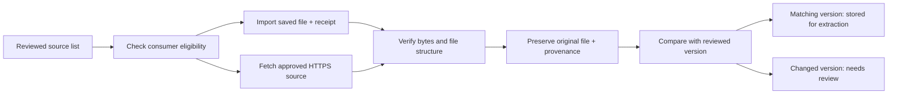

# Source acquisition: P1.3–P1.6

These tasks implement the first working **HTML and PDF intake pipeline** from the
[implementation plan](implementation-plan.md). It collects and checks files, preserves
their origin, and stores them for the extraction work in Phase 2. It does not yet create
chunks, embeddings, a searchable index, or chatbot answers.

## What each task means in everyday language

| Task | Plain-language explanation | Example | What you can inspect |
| --- | --- | --- | --- |
| **P1.3 — Import reviewed files** | Put an already-downloaded, approved document into our project library, together with its original receipt. | Copy the reviewed cold-storage web page and cross-contamination PDF into storage. Keep when they were originally downloaded. | Original bytes, URL, download/check time, fingerprint, and document version in SQLite. |
| **P1.4 — Check the actual file** | Open the package and check what is inside. A name ending in `.pdf` does not prove it contains a PDF. | Reject a login page returned instead of a document; open a real PDF and count its pages. | Detected format, PDF page/text classification, warnings, or a specific failure reason. |
| **P1.5 — Fetch bounded downloads** | Send a controlled courier to approved websites. Limit how long it waits, how much it downloads, where it can go, and how often it retries. | Follow a redirect within the approved host; reject a redirect to an unrelated host or a private computer address. | New acquisition receipt with the final URL and actual retrieval time, or failure metadata. |
| **P1.6 — Provide commands and reports** | Give the engineer a repeatable control panel and a receipt for each run. | Run `import-source` or `fetch-sources`, then read their JSON results. | Outcome counts, acquisition/version IDs, URLs, times, hashes, file paths, inspection results, and reasons. |

For a beginner AI engineer, this establishes trustworthy inputs before trying extraction
or RAG. For a vibe coder, the commands and reports make each experiment repeatable and
debuggable. For a PM, completion means **two verified stored development inputs and a
working intake process**; it does not mean the chatbot can answer questions yet.



**Provenance** is the document's chain of receipts: who published it, which URL supplied
it, when we downloaded it, and which exact file we saved. **SHA-256** is a file fingerprint:
identical bytes produce the same value; a byte change produces a different value.
**SQLite** is our local catalog of those receipts. A fingerprint change does not by itself
prove that the nutritional guidance changed; even page-template changes can alter it.

## Install and run

From the repository root, using Python 3.11 or later:

```sh
source .venv/bin/activate
python -m pip install --require-hashes -r requirements/acquisition.lock
python -m pip install --no-deps --no-build-isolation -e .
dietary-rag check-registry
```

The new locked dependencies are HTTPX/HTTPcore for downloading and pypdf for file-level
PDF inspection. Their imports are lazy; the settings and registry checks still work with
core dependencies. Development tests require both `dev.lock` and `acquisition.lock`.
OCR, full layout extraction, model downloads, and API credentials are not needed here.

Import the reviewed development files and their original JSON receipts:

```sh
dietary-rag import-source mn_cold_storage \
  --file data/staging/source_review/2026-11-11/mn_cold_storage.html \
  --evidence data/staging/source_review/2026-11-11/mn_cold_storage.json \
  --report data/staging/acquisition-reports/mn_cold_storage-import.json

dietary-rag import-source mn_cross_contamination_pdf \
  --file data/staging/source_review/2026-11-11/mn_cross_contamination_pdf.pdf \
  --evidence data/staging/source_review/2026-11-11/mn_cross_contamination_pdf.json \
  --report data/staging/acquisition-reports/mn_cross_contamination_pdf-import.json
```

These input files are available in the review machine's ignored staging directory; they
are not bundled in Git. A clean checkout can fetch approved sources instead. An import
requires a real saved acquisition receipt, not an invented current timestamp.

```sh
dietary-rag fetch-sources mn_cold_storage mn_cross_contamination_pdf \
  --report data/staging/acquisition-reports/live-two-source-fetch.json

# Explicit opt-in to download all currently eligible reviewed consumer candidates:
dietary-rag fetch-sources --all-eligible \
  --report data/staging/acquisition-reports/all-eligible-fetch.json
```

Choose IDs or `--all-eligible`, never both. Unknown IDs and invalid selections are rejected
before downloads or database writes. There is no automatic crawl of every candidate URL.
Duplicate requested IDs are processed once. Both commands support `--project-root` and
`--config`; relative input/evidence/report paths are relative to the project root.

Every command prints JSON; `--report` also saves it atomically. A report is a replaceable
run summary, while the SQLite receipts and original file artifacts preserve history.
Use different report names when you want to retain every run summary.

## Outcomes and storage

| Outcome | Meaning | Next action |
| --- | --- | --- |
| `stored` | Valid file matches the reviewed bytes, final URL, and PDF inspection; a document version is recorded. | Use as a development input for Phase 2 extraction. |
| `needs_review` | Valid newly acquired file differs from the reviewed hash, URL, or PDF inspection. Bytes and acquisition are retained, but no approved document version is created. | Inspect the difference and explicitly update the source review/registry if appropriate before another acquisition run. |
| `failed` | Network, HTTP, size, receipt, format, or document checks failed. Failure metadata is recorded; the response is not stored as approved content. | Read `failure_code` and fix or investigate the cause. |
| `blocked` | The source fails the existing consumer eligibility rules. Its file is not read and its URL is not fetched. | Review the selection reason; do not use it to fill consumer coverage quotas. |

Exit code `0` means all requested results were stored; `1` means at least one result was
blocked, failed, or needs review; `2` means invalid configuration/arguments, missing
dependencies, or an operational error prevented command completion. The commands do not
edit the registry or publish an active corpus. PDF images and excluded sections remain
subject to the existing rights and extraction gates, even after a file is stored.

Default output locations, under the configured `data_dir`:

| Location | Contents |
| --- | --- |
| `staging/raw/sha256/<prefix>/<digest>.blob` | Immutable exact HTML/PDF bytes, addressed by fingerprint. Format comes from metadata, not the `.blob` suffix. |
| `staging/provenance.sqlite` | Registry snapshots, acquisitions, artifacts, document versions, and their links. |
| Explicit `--report` path | JSON run summary with outcomes and acquisition provenance. |

Repeat import of the same file and receipt reuses the artifact, acquisition, and document
version IDs. A fresh download with identical bytes reuses the original artifact but records
a new acquisition time and version linked to that new receipt. Source publication years,
edition labels, and original review date observations remain separate from download times.
Legacy review receipts contain `checked_at` for the original download/check operation;
when `retrieved_at` is absent, that original recorded instant is retained. File modification
times and today's import time are never substituted as source retrieval dates.

## File checks and download limits

HTML checks detect actual HTML structure and reject obvious challenge/login pages,
script-only application shells, and short download-only summaries. These are file-level
heuristics, not a guarantee that every HTML page contains useful guidance. Main-article,
table, and exclusion-aware parsing belongs to Phase 2.

PDF checks require `%PDF-`, successful strict opening, an unencrypted document, and
1–2,000 physical pages. Text inspection distinguishes selectable text, sparse text pages,
image-bearing scans/mixed documents, and unknown/blank documents. This is a preliminary
classification rather than OCR. Tables, printed page labels, reading order, and visual
fidelity are later extraction checks. A conflicting content-type header produces a warning
when the actual file matches the registered format; actual HTML returned for a registered
PDF fails explicitly.

Fetch defaults in [settings.yaml](../config/settings.yaml): 20-second network timeouts and
an attempt deadline checked at redirects/body chunks, two retries (at most three attempts),
five redirects, 5 MiB HTML and 60 MiB PDF limits. Headers and streamed bytes are both bounded.
Retries apply to transport/timeouts and HTTP 429/500/502/503/504 with bounded backoff;
403/404/405 and invalid documents do not retry. DNS waiting is bounded; an OS resolver
worker may finish later after the caller has timed out.

Only HTTPS on port 443, with no credentials, is allowed. Redirects may use the exact hosts
already present in that source's reviewed original/resolved URLs. DNS results must all be
public; the transport connects to the verified IP while retaining the original host for
TLS certificate verification and the Host header. Proxy environment variables are ignored.
Downloads request identity encoding and reject unexpected compressed HTTP bodies so the
stored file preserves the exact document bytes without decompression ambiguity.

## Verified results and remaining work

On November 11, 2026, the two import commands stored:

| Input | Original acquisition instant (UTC) | Exact bytes | Inspection |
| --- | --- | --- | --- |
| `mn_cold_storage` | `2026-11-11T12:15:58.864894Z` | 81,507 | HTML |
| `mn_cross_contamination_pdf` | `2026-11-11T12:19:47.140759Z` | 122,707 | PDF, 1 page, selectable text |

Repeating both imports retained those times and identities. The live two-source fetch
returned a matching PDF and a changed HTML fingerprint: the PDF was stored and reused its
artifact, while the HTML was retained as `needs_review`. The approved HTML was preserved.
The report and provenance database are in the ignored staging locations above.

Automated tests run without external network access and cover actual valid PDFs,
encrypted/corrupt documents, scans/blank pages, HTML challenge/shell/format failures,
receipt mismatch, old acquisition-time preservation, idempotence, consumer blocking,
changed-file review handling, HTTP errors/retry limits, safe/unsafe redirects, private/mixed
DNS, pinned IP connections, DNS/attempt timeouts, byte limits, and CLI report/exit behavior.
The full suite passes **125 tests** on Python 3.13; lint, formatting, registry validation,
dependency consistency, and wheel-build checks also pass.

P1.3–P1.6 are complete. **P1.7 is now also complete:** see [coverage review](phase1-coverage.md)
for 16 byte-verified acquired consumer families and six official default PDFs. Continue toward Phase 2's
HTML/native-PDF extraction and cleaning; OCR, chunks, vectors, retrieval, and answering
remain later work.
