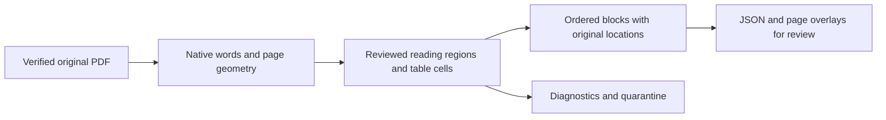

# Phase 2.2: native PDF extraction

**Current downstream status:** The extraction-stage results below record this phase's scope and review state at completion. Shared normalization and [structure-aware chunking](phase2-chunking.md) are now implemented, and the Phase 2 ingestion development gate has passed. Native outputs still require exact downstream review receipts; uncertain OCR remains quarantined. Vector indexing and activation remain planned.

**Completed November 12, 2026: P2P.1–P2P.4.** The six selected PDFs produce **265 ordered native blocks, 30 physical pages and one contextual table**. Three explicitly selected, approved alternate PDFs add comparison coverage: together the nine documents produce **319 blocks across 37 pages and three tables**. These alternates do not increase consumer-family counts. The [source review record](pdf-extraction-review.json) contains original hashes, extraction identities, page mappings, diagnostics, render hashes and comparisons of all **146 original table cells**. Outputs remain `pending` downstream review.

## What this does, in simple terms

A PDF usually stores letters at positions on a page. It often has no equivalent of a webpage's paragraph or table tags. Reading everything from left to right across the page can mix two unrelated columns. This extractor uses reviewed page regions to read each column in order and builds separate records for headings, paragraphs, lists, captions, notes and tables.

Each record keeps its original file identity and its location. A location includes the physical page and a rectangle around the original words. The printed page number is a separate field: the Dietary Guidelines' third physical page says `2` in its footer. Keeping both means a future citation can open the correct page while also showing the number the reader sees. PDF navigation labels are recorded separately again; they are not evidence that a number was printed.

Tables retain relationships. In the storage chart, `21` belongs to fresh eggs in the shell under `Refrigerator (Days at 40°F)`, while the freezer cell says `don't freeze`. The TV-dinners refrigerator cell is blank, and stays blank. In FDA's cooking table, `145 °F` stays together with `a 3 minute rest time`. Table notes stay attached so later processing can distinguish food quality from food safety and household guidance from regulated-facility exceptions.

Repeated page titles and page-number furniture can be removed from the retained text, while creation/revision dates and meaningful safety notes survive. Images and visual-only guidance are disclosed as omissions. The extractor does not infer a recommendation from a picture. If expected text is missing or a table boundary/header is ambiguous, it reports a quarantine result rather than making the uncertain table available as a retained block.



This is the evidence foundation. OCR, normalization, tokenizer-sized chunks, indexing and chatbot answers are later tasks.

## Run it

Use the existing Phase 1 acquisition catalog and virtual environment:

```sh
python -m pip install --require-hashes -r requirements/pdf.lock
python -m dietary_rag extract-pdf mn_cross_contamination_pdf \
  --report data/staging/pdf-extraction/single-report.json
python -m dietary_rag extract-pdf --all-eligible \
  --report data/staging/pdf-extraction/report.json \
  --render-dir data/staging/pdf-extraction/renders
```

`--all-eligible` selects the registry's eligible PDFs. Explicit source IDs also work. `--output-dir`, `--config` and `--project-root` follow the existing commands. Rendering is optional; it writes the original page and a geometry overlay for every physical page. Red boxes show retained block locations and sequence numbers; green boxes show table cells and orange boxes show category/excluded rows.

The command reads SQLite and the original-byte store without changing acquisitions or activating a corpus. It selects the latest retrieved version under the current review snapshot, with version ID as the equal-time tie breaker. It verifies bytes and reviewed metadata before parsing. Identical inputs/configuration produce identical extraction identities and JSON. Exit code `0` means successful native extraction, `1` means a source failed or was quarantined, and `2` means invalid selection/configuration. The report distinguishes each outcome.

Approved alternate PDFs have a separate, explicit comparison path:

```sh
python -m dietary_rag extract-pdf mn_storage_chart_pdf --comparison \
  --file /path/to/original-reviewed.pdf \
  --evidence /path/to/original-acquisition-receipt.json \
  --report data/staging/pdf-extraction/storage-comparison-report.json
```

This requires one approved comparison ID, original reviewed bytes and the existing Phase 1 `SourceEvidence` receipt. The source URL, hash, byte count and original receipt dates must match the review. It does not invent a new retrieval date or write a catalog version. Comparison exports carry `comparison_only: true` and cannot become default evidence through this command.

## Technical foundations

The implementation is in [pdf.py](../src/dietary_rag/ingestion/pdf.py), [pdf_profiles.py](../src/dietary_rag/ingestion/pdf_profiles.py), [pdf_contracts.py](../src/dietary_rag/ingestion/pdf_contracts.py) and [pdf_review.py](../src/dietary_rag/ingestion/pdf_review.py).

1. **Native words and pages:** pypdf validates the file, encryption/page count, rotation and navigation labels. pdfplumber/pdfminer expose native words, fonts and bounding boxes. Coordinates use PDF points (72 per inch), with origin at the top left. Physical pages are one-based. Duplicate overlapping painted characters are removed before grouping; ordinary repeated recommendations are not removed by that step.
2. **Reviewed layout profiles:** each source has explicit ordered page regions and expected table geometry. Profiles bind to reviewed SHA-256 bytes, parser profile and a registry-selection fingerprint. Changed source bytes, exclusions or unreviewed layouts require another review. Conservative masks omit calorie/calculator, supplement, clinical and other excluded regions, including adjacent label/lookup examples. This is a bounded adapter for the inspected documents, not an arbitrary-PDF parser.
3. **Furniture and blocks:** words are grouped into lines and paragraph/list/heading blocks within each reviewed region. Repeated margin text is detected separately, with protection for dates and meaningful notes. `PDFBlockLayout` links each retained block back to its native word IDs. `ContentBlock` stores section context, order, original document-version ID and one or more page rectangles.
4. **Tables:** default detection is diagnostic, not authoritative. Reviewed explicit cell boundaries recover the storage chart even when default detection finds zero tables. Native cell text, spans, empty cells, categories, headers and source geometry remain in `PDFTablePart`; retained rows also become a canonical shared table block with `TableContext`. FDA's source prints a spanning title but no individual column headings, so its explicitly reviewed column roles are tagged `reviewed_column_roles`. No temperature or missing cell value is invented. Cross-boundary words, unresolved headers or missing expected detection quarantine the table. Excluded rows remain administrative comparison data, without a retained canonical row.
5. **Continuations:** explicit profile keys join compatible prose or table parts across pages while retaining all locations. Continued tables keep their native repeated headers, cells and part-to-part page relationship. Incompatible headings/types or changed table headers are rejected or quarantined. Synthetic two-page fixtures exercise these relationships because the selected native tables fit on single pages.
6. **Validation and identities:** Pydantic checks page maps, ordered document/block relationships, word/layout references, cell/row widths and quarantine relationships. Configuration identity includes profile geometry, parser version, library versions and Python minor version. Extraction identity includes the complete native result. Signature/hash mismatch, encryption, corrupt files, changed metadata and expected regions without text cannot silently produce successful evidence. Parsing is bounded at 100 pages and 100,000 native words; rendering has DPI and pixel bounds.

`PDFExtractor.extract()` implements the shared block interface and raises if its report is quarantined. `extract_report()` additionally exposes the native words, page mappings, layouts, tables and diagnostics. Raw words, omitted-word references and original table cells deliberately include excluded text for administrative review. Downstream consumer processing must use retained blocks and rows, not all native words or diagnostic text.

## Reviewed layouts

| Source | Selection | Pages | Blocks | Tables | Reviewed handling |
| --- | --- | ---: | ---: | ---: | --- |
| Dietary Guidelines 2025–2030 | Default | 10 | 65 | 0 | Columns, physical/printed mismatch, reviewed general-guidance regions; exclude foreword, infant/clinical/pregnancy and target/supplement material. |
| HHS adults and older adults | Default | 8 | 57 | 0 | Illustrated cards and labels; exclude calculators, worked label/limits and supplement/clinical cards. |
| HHS kids and teens | Default | 8 | 73 | 0 | Cards, recipe columns and preparation order; omit calculator and worked-label/limit regions. |
| NHLBI sodium tips | Default | 2 | 14 | 0 | Multiple columns and dining-out cards; omit clinical promotional text and second-page nutrient lookup. |
| Minnesota cross-contamination | Default | 1 | 31 | 0 | Nested lists and independent preparation columns; preserve created/modified footer. |
| Minnesota safe grilling | Default | 1 | 25 | 1 | Six retained safety rows; omit conflicting whole-cut row and color-doneness wording; retain regulated-facility qualifier and dates. |
| Minnesota storage chart | Comparison | 1 | 5 | 1 | 28 data rows, six category bands, three columns, blank refrigerator value and freezer-quality qualification. |
| FDA safe handling | Comparison | 2 | 22 | 1 | Two columns, 12 native table rows, full temperature/rest conditions, spanning source title and March 2017 date. |
| FDA produce | Comparison | 4 | 27 | 0 | Reviewed preparation/storage regions, pre-washed qualification and July 2023 dates; omit illness pages and alternate general-handling material. |

All 37 original pages were rendered and inspected against the retained regions. All 146 source cells were independently cropped and compared using whitespace-normalized `extract_text`; numeric tokens match too. The review record includes cells excluded from canonical evidence, making those decisions inspectable. There are 46 retained data rows across the three tables. Comparison source recommendations remain separate editions/alternates, pending downstream reconciliation.

Committed [storage](examples/pdf-layout-review/mn_storage_chart_pdf.png), [cross-contamination](examples/pdf-layout-review/mn_cross_contamination_pdf.png) and [FDA handling](examples/pdf-layout-review/fda_safe_handling_pdf.png) overlay samples use the portable text-only fixtures. They omit source images/logos/art and are explicitly reconstructed layouts. Original-page review renders remain in ignored staging; their hashes are recorded in the source review JSON.

## Verification and limits

The full suite passes **188 tests**, including **26 PDF unit/CLI cases**, on Python 3.13. Ruff lint/format, dependency consistency, registry validation and wheel build pass. Real extraction succeeds for all six default sources and three approved comparisons. Repeated CLI exports preserve identities; tests verify read-only catalog use and comparison receipt checks.

Nine [portable native-text fixtures](../tests/fixtures/pdf/manifest.json) recreate source word coordinates with substitute fonts and omit source artwork. The [fixture builder](../scripts/build_pdf_text_fixtures.py) consumes explicit successful extraction reports. Golden table values cover every retained/category/excluded row. Additional project-created cases cover multi-page recommendations/tables, rotated pages, printed labels that disagree with PDF navigation labels, repeated furniture, safety/date footers, missed detection, crossing cell words, blank/unresolved headers, empty native regions, corrupted/encrypted bytes and invalid references. Fixture rendering was visually checked; decorative title duplication on excluded cover/logo areas reflects reconstructed native text and is not retained guidance.

These checks establish native extraction fidelity, not full semantic approval. Sparse/scanned pages need the later OCR classification/fallback tasks. Visual-only content is omitted and recorded. At the P2P checkpoint, normalization, final exclusion/quality review, chunking and activation were still pending; P2P completion alone did not close the Phase 2 gate. Subsequent normalization/chunking completion is recorded in the current downstream status above.

## Subsequent normalization correction

The P2N.3 review found that NHLBI's dining-card x ranges omitted some words and mixed the fourth/fifth cards. The native profile now uses corrected boundaries, restoring the complete five tips. Regenerate PDF exports before normalization; old artifacts remain inspectable but their dining-region review is superseded. See [normalization review](normalization-review.json) for five independent original-page crop comparisons and [the corrected fixture overlay](examples/normalization-review/nhlbi-dining-regions.png). Acquisition bytes, table values and source selection are unchanged.
